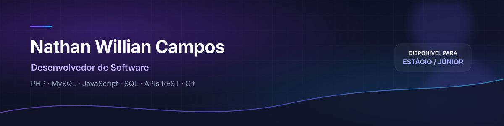

  

**Nathan Willian Campos** · **@Neisanta**

Desenvolvedor de software em formação, construindo aplicações web e aprendendo a transformar requisitos em soluções claras, seguras e úteis.

---

## Apresentação

Estudante de **Análise e Desenvolvimento de Sistemas (ADS)** na **FATEC Baixada Santista**, em Santos (SP), em transição profissional para a área de Tecnologia da Informação.

Desenvolvo projetos próprios de aplicações web com foco em **backend, modelagem de dados, APIs REST, autenticação e interfaces responsivas**. Busco uma oportunidade de estágio ou vaga júnior para aprender em equipe, contribuir com soluções de software e evoluir como desenvolvedor.

## Sobre mim

- Construo aplicações do modelo de dados à interface, priorizando código organizado e comandos de execução reproduzíveis.
- Pratico **PHP, MySQL, SQL, JavaScript, HTML5 e CSS3** em projetos pessoais com autenticação, CRUD e comunicação entre componentes.
- Aplico conceitos de segurança web como senha com hash, sessões, tokens CSRF, validação de entrada e prepared statements.
- Uso **Git e GitHub** para versionamento e organização dos projetos.
- Estou em formação contínua em **Java e programação orientada a objetos**, além de fundamentos em **C** e **Python**.

## Tecnologias e ferramentas

| Área | Tecnologias | uso neste portfólio |
|---|---|---|
| **Backend** | PHP 8, APIs REST em JSON, sessões e cookies | Aplicações web, autenticação e operações CRUD |
| **Frontend** | JavaScript, HTML5, CSS3, `fetch`, polling e Chart.js | Interfaces responsivas, atualização assíncrona e gráficos |
| **Bancos de dados** | MySQL/MariaDB, SQL, PDO e MySQLi | Modelagem relacional, consultas preparadas e persistência |
| **Linguagens** | JavaScript; PHP | Implementação de aplicações completas |
| **Em formação** | Java, POO, C e Python | Estudos de fundamentos e orientação a objetos |
| **Ferramentas** | Git, GitHub, XAMPP, Apache e phpMyAdmin | Versionamento, ambiente local e revisão de código |

> As tecnologias marcadas como **em formação** ainda não são apresentadas como experiência prática equivalente aos projetos disponíveis neste perfil.

## Projetos em destaque

<table>
  <tr>
    <td width="50%" valign="top">
      <h3>FinLife</h3>
      
<strong>Organização financeira pessoal com PHP, MySQL e JavaScript.</strong> Dashboard, receitas, despesas, contas, categorias, metas, cartões, compromissos e assistente com IA. As APIs usam autenticação, JSON e endpoints REST-style; o módulo de mercado consulta provedores públicos e informa fonte, horário e estado do cache.

      
<code>PHP</code> <code>MySQL</code> <code>JavaScript</code> <code>REST-style API</code>

      
<a href="https://github.com/Neisanta/FinLife">Código</a> · <a href="https://finlife.spssolar.com.br/login">Demonstração</a>

      
<em>Projeto em evolução; não possui integração com Open Finance ou conexão bancária real.</em>

    </td>
    <td width="50%" valign="top">
      <h3>Omigos Chat</h3>
      
<strong>Chat web entre usuários.</strong> Cadastro e login, conversas diretas, mensagens por polling assíncrono, indicador de digitação, presença, contador de não lidas, edição, exclusão, anexos de imagem e painel administrativo.

      
<code>PHP</code> <code>MySQL</code> <code>JavaScript</code> <code>AJAX</code> <code>Segurança web</code>

      
<a href="https://github.com/Neisanta/Omigos">Código e instruções</a>

      
<em>Base funcional para execução local; sem demonstração pública.</em>

    </td>
  </tr>
  <tr>
    <td width="50%" valign="top">
      <h3>SPS Solar</h3>
      
<strong>Landing page institucional responsiva.</strong> Interface de navegação, seções de apresentação, projetos, gráfico comparativo com Chart.js, simulador de economia e chamadas para contato por WhatsApp.

      
<code>HTML5</code> <code>CSS3</code> <code>JavaScript</code> <code>Chart.js</code>

      
<a href="https://github.com/Neisanta/SPS-Solar">Código</a> · <a href="https://spssolar.com.br">Demonstração</a>

    </td>
    <td width="50%" valign="top">
      <h3>Menino da Trufa</h3>
      
<strong>Catálogo e fluxo de pedido em uma única página.</strong> Catálogo responsivo, preços promocionais, pedido por WhatsApp, cópia de chave PIX e painel demonstrativo com persistência local no navegador.

      
<code>HTML5</code> <code>CSS3</code> <code>JavaScript</code> <code>localStorage</code>

      
<a href="https://github.com/Neisanta/trufa">Código</a> · <a href="https://neisanta.github.io/trufa/">Demonstração</a>

      
<em>O painel local é demonstrativo e não oferece segurança de autenticação real.</em>

    </td>
  </tr>
</table>

## Experiência prática aplicada

Nos projetos deste perfil, pratiquei:

- **Modelagem de banco de dados:** criação de relações, chaves estrangeiras, índices e isolamento de dados por usuário.
- **Backend e APIs:** controllers, models, endpoints REST-style, validação, respostas JSON e regras de negócio.
- **Autenticação e segurança:** hash de senha, sessão, “lembrar de mim”, CSRF, rate limiting e prepared statements.
- **Frontend e integração:** JavaScript assíncrono com `fetch`, polling, formulários, gráficos e interfaces responsivas.
- **Organização e continuidade:** separação entre apresentação, acesso a dados e regras de negócio; uso de Git e GitHub.

## Formação acadêmica

**Análise e Desenvolvimento de Sistemas**  
FATEC Baixada Santista — Santos, São Paulo  
*Curso em andamento.*

## Objetivos profissionais

- Estágio em desenvolvimento de software ou backend.
- Vaga júnior em PHP ou Java.
- Oportunidade em suporte técnico e infraestrutura com foco em desenvolvimento.
- Evolução em APIs REST, bancos de dados e qualidade de software.

## Contato e links

- **GitHub:** [@Neisanta](https://github.com/Neisanta)
- **Código e demonstrações:** disponíveis nos repositórios deste perfil.

  Feito com foco em clareza, credibilidade e evolução contínua.

